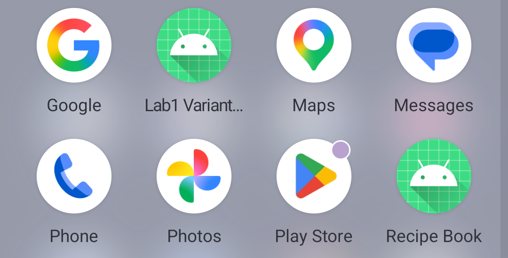
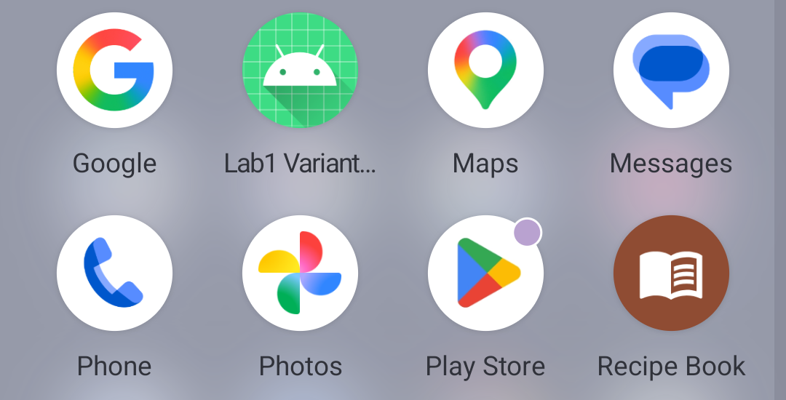
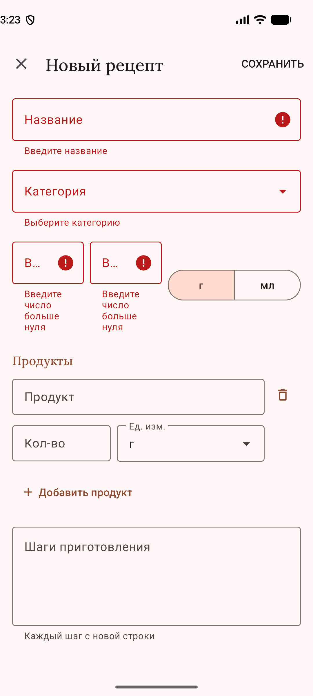
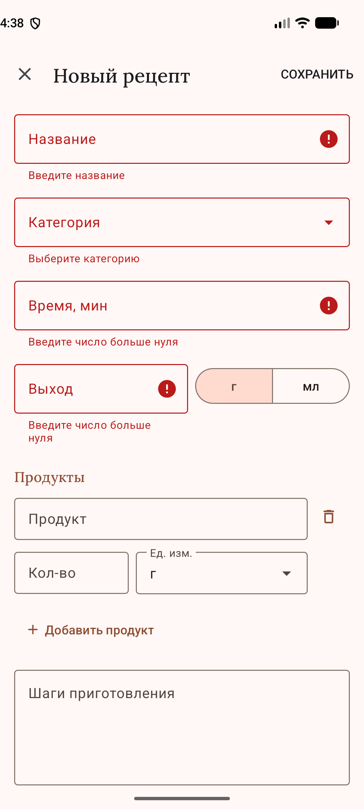
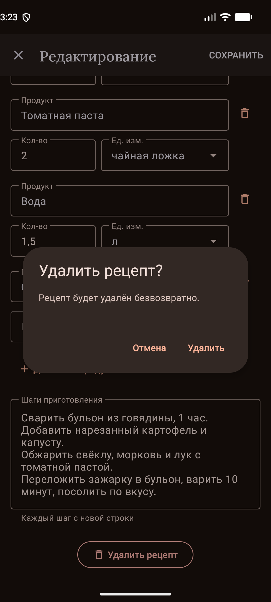
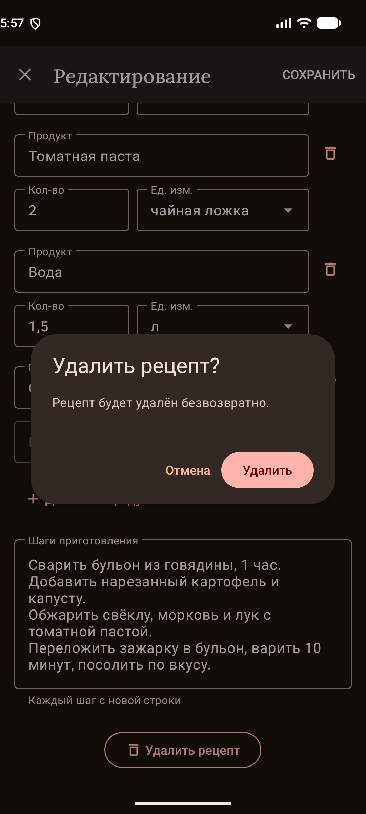
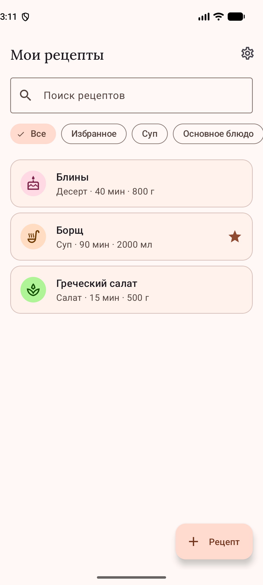
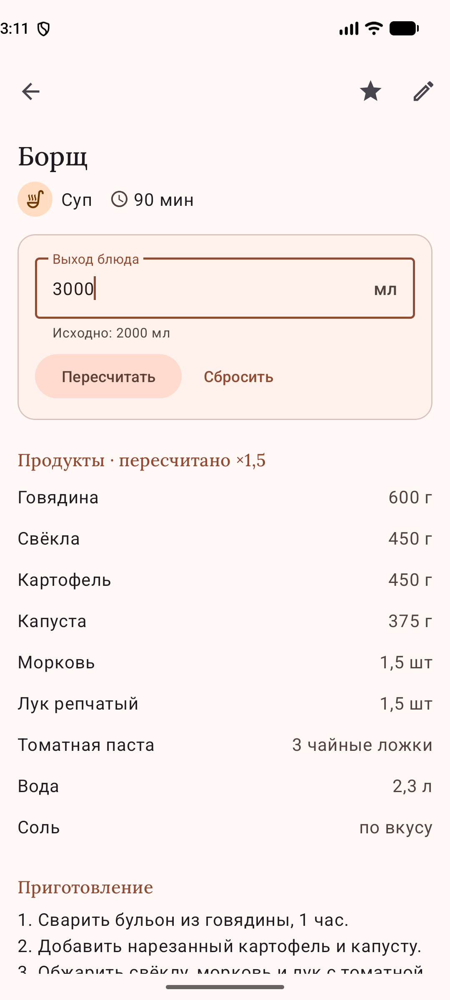
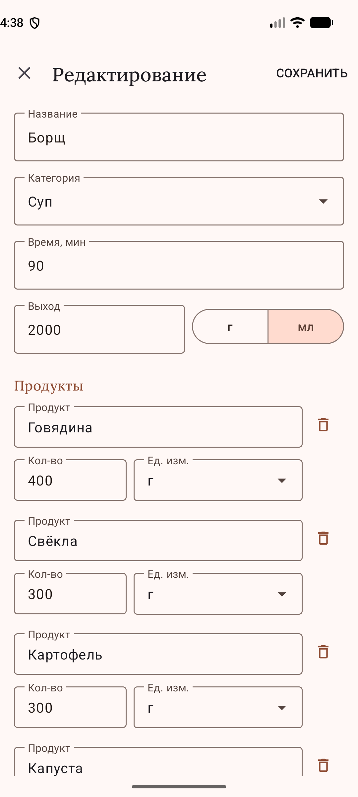
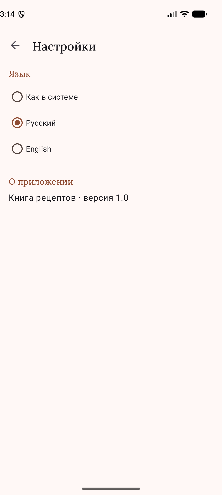

# Лабораторные работы №2–4 — «Книга рецептов»

Android-приложение на Kotlin: личная книга рецептов с пересчётом продуктов под нужный выход блюда.

## Задание

- **ЛР 2** — спроектировать приложение (идея, данные, экраны, дизайн) и сверстать экраны.
- **ЛР 3** — реализовать приложение по плану ЛР 2: все функции плана должны работать.
- **ЛР 4** — доработать интерфейс: цвета, темы и стили по плану ЛР 2.

## Возможности

- **Список рецептов:** поиск по названию, фильтры по категориям и «Избранное».
- **Рецепт:** продукты и шаги приготовления, добавление в избранное.
- **Пересчёт пропорций:** ввести нужный выход блюда — количества продуктов пересчитываются
  (граммы и миллилитры до целых, остальное до десятых, «по вкусу» не меняется); «Сбросить»
  возвращает исходные.
- **Редактор:** создание и изменение рецепта, категория и единицы из списков, строки продуктов
  с подсказками из справочника, проверка полей, удаление с подтверждением.
- **Настройки:** язык интерфейса — как в системе, русский или английский.
- Светлая и тёмная тема по настройке системы. Данные хранятся на устройстве, интернет не нужен.
  При первом запуске — три стартовых рецепта.

## Доработки интерфейса (ЛР 4)

- **Значок приложения:** своя адаптивная иконка — белая книга на основном цвете палитры `#8F4C33`
  вместо робота из шаблона, с монохромным слоем для тематических значков Android 13+.
- **Редактор:** «Время, мин» — отдельное поле на всю ширину, «Выход» и переключатель «г / мл» —
  в одной строке, переключатель стоит на уровне поля. Подписи и сообщения об ошибках не обрезаются.
- **Диалог удаления:** кнопка «Удалить» залита цветом ошибки (`colorError` / `colorOnError`) через
  наложение темы `ThemeOverlay.RecipeBook.DeleteDialog` — её не спутать с «Отменой» ни в светлой,
  ни в тёмной теме.
- **Тёмная тема:** проверены все экраны, удалён неиспользуемый цвет `md_theme_scrim`.

| | Было | Стало |
|---|---|---|
| Значок |  |  |
| Ошибки в редакторе |  |  |
| Диалог в тёмной теме |  |  |

## Структура

Код — в [`app/src/main/java/com/example/recipebook/`](app/src/main/java/com/example/recipebook/):

- [`data/model/`](app/src/main/java/com/example/recipebook/data/model/) — таблицы базы
  (`Recipe`, `Ingredient`, `RecipeIngredient`) и перечисления категорий и единиц;
- [`data/db/`](app/src/main/java/com/example/recipebook/data/db/) — запросы (`RecipeDao`,
  `IngredientDao`) и база `RecipeDatabase`;
- [`data/`](app/src/main/java/com/example/recipebook/data/) — `RecipeRepository` и стартовые рецепты;
- [`domain/`](app/src/main/java/com/example/recipebook/domain/) — пересчёт количества (`Scaling`)
  и приведение названий продуктов к единому виду (`IngredientNames`);
- [`ui/`](app/src/main/java/com/example/recipebook/ui/) — экраны `list`, `detail`, `editor`,
  `settings`, их ViewModel и адаптеры списков;
- [`RecipeBookApp.kt`](app/src/main/java/com/example/recipebook/RecipeBookApp.kt) — класс
  приложения: создаёт базу и репозиторий.

Стек: Kotlin, XML-разметка и ViewBinding, Material Components (Material 3), Room (SQLite) + KSP,
ViewModel, корутины и Flow, RecyclerView; minSdk 24.

## Скриншоты

   

## Демонстрация

ЛР 3 — все функции приложения:

<video src="https://github.com/user-attachments/assets/cc43815c-4b4a-42be-99c8-8181e653465f" controls width="300"></video>

ЛР 4 — доработки интерфейса:

<video src="https://github.com/user-attachments/assets/52b4d954-3f5b-49e0-a197-7b31a4f51b24" controls width="300"></video>

## Запуск

Открыть папку `lab2-recipe-book` в Android Studio и нажать Run.

## Шрифт

Заголовки набраны шрифтом Lora © The Lora Project Authors, SIL Open Font License 1.1.
