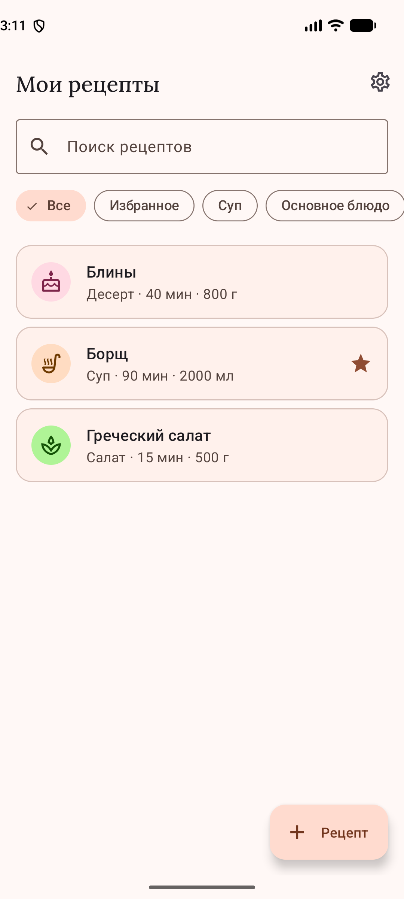
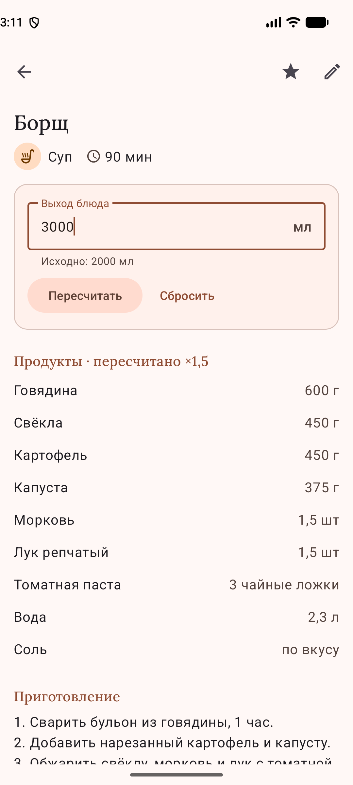
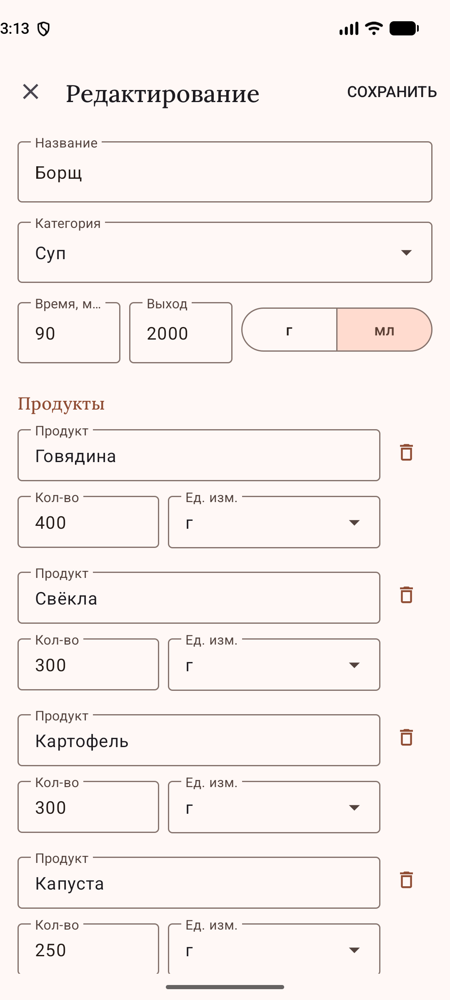
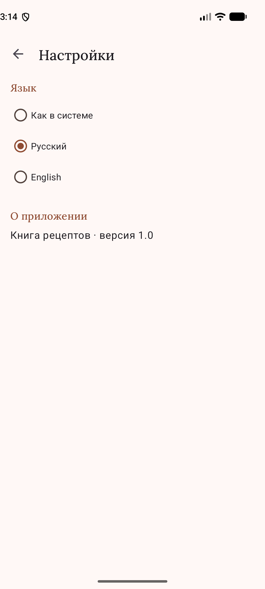

# Лабораторные работы №2–3 — «Книга рецептов»

Android-приложение на Kotlin: личная книга рецептов с пересчётом продуктов под нужный выход блюда.

## Задание

- **ЛР 2** — спроектировать приложение (идея, данные, экраны, дизайн) и сверстать экраны.
- **ЛР 3** — реализовать приложение по плану ЛР 2: все функции плана должны работать.

## Возможности

- **Список рецептов:** поиск по названию, фильтры по категориям и «Избранное».
- **Рецепт:** продукты и шаги приготовления, добавление в избранное.
- **Пересчёт пропорций:** ввести нужный выход блюда — количества продуктов пересчитываются
  (граммы и миллилитры до целых, остальное до десятых, «по вкусу» не меняется); «Сбросить»
  возвращает исходные.
- **Редактор:** создание и изменение рецепта, категория и единицы из списков, строки продуктов
  с подсказками из справочника, проверка полей, удаление с подтверждением.
- **Настройки:** язык интерфейса — как в системе, русский или английский.
- Светлая и тёмная тема по настройке системы. Данные хранятся на устройстве, интернет не нужен.
  При первом запуске — три стартовых рецепта.

## Структура

Код — в [`app/src/main/java/com/example/recipebook/`](app/src/main/java/com/example/recipebook/):

- [`data/model/`](app/src/main/java/com/example/recipebook/data/model/) — таблицы базы
  (`Recipe`, `Ingredient`, `RecipeIngredient`) и перечисления категорий и единиц;
- [`data/db/`](app/src/main/java/com/example/recipebook/data/db/) — запросы (`RecipeDao`,
  `IngredientDao`) и база `RecipeDatabase`;
- [`data/`](app/src/main/java/com/example/recipebook/data/) — `RecipeRepository` и стартовые рецепты;
- [`domain/`](app/src/main/java/com/example/recipebook/domain/) — пересчёт количества (`Scaling`)
  и приведение названий продуктов к единому виду (`IngredientNames`);
- [`ui/`](app/src/main/java/com/example/recipebook/ui/) — экраны `list`, `detail`, `editor`,
  `settings`, их ViewModel и адаптеры списков;
- [`RecipeBookApp.kt`](app/src/main/java/com/example/recipebook/RecipeBookApp.kt) — класс
  приложения: создаёт базу и репозиторий.

Стек: Kotlin, XML-разметка и ViewBinding, Material Components (Material 3), Room (SQLite) + KSP,
ViewModel, корутины и Flow, RecyclerView; minSdk 24.

## Скриншоты

   

## Демонстрация

<video src="https://github.com/user-attachments/assets/cc43815c-4b4a-42be-99c8-8181e653465f" controls width="300"></video>

## Запуск

Открыть папку `lab2-recipe-book` в Android Studio и нажать Run.

## Шрифт

Заголовки набраны шрифтом Lora © The Lora Project Authors, SIL Open Font License 1.1.
